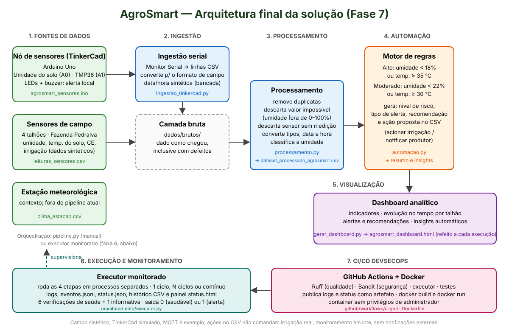

# AgroSmart — Fase 7 (FIAP)

Plataforma didática integrada de monitoramento do solo: sensor simulado no TinkerCad → processamento Python → automação por regras → dashboard HTML + SVG offline. A Fase 7 acrescenta a **execução automatizada com monitoramento** (logs, indicadores e verificações de saúde por ciclo) e o **pipeline DevSecOps** (GitHub Actions + Docker). Campo sintético; ações propostas registradas em CSV, sem atuador real. Veja `ESTADO_ENTREGA.md` e a matriz de evidências em `REVISAO_ENTREGA.md`.



## Itens da Fase 7

| # | Item | Onde está |
|---|---|---|
| 1 | Arquitetura final da solução | `docs/arquitetura.md`, `arquitetura.svg`, `arquitetura.png` |
| 2 | Execução da plataforma (sistema funcional) | `docs/execucao_plataforma.md`, `docs/evidencias_execucao/`, `pipeline.py` |
| 3 | Pipeline DevSecOps | `docs/pipeline_devsecops.md`, `.github/workflows/ci.yml`, `Dockerfile`, `.dockerignore`, `ruff.toml` |
| 4 | Monitoramento e execução automatizada | `monitoramento/` (`executor.py`, `MONITORAMENTO.md`, `TUTORIAL_como_testar.md`, `evidencias/`) |
| 5 | Análise de processo e demonstração final | `docs/analise_processo.md` |
| 6 | Apresentação (pitch) | `PITCH.md` |

## Como rodar

```bash
python -m pip install -r requirements.txt
python pipeline.py                                          # fluxo completo, do sensor ao dashboard
python monitoramento/executor.py                            # o mesmo fluxo, monitorado (1 ciclo)
python monitoramento/executor.py --ciclos 3 --intervalo 5   # 3 ciclos seguidos
python monitoramento/executor.py --status                   # situação do último ciclo
python -m unittest discover -s tests -v                     # 30 testes
```

Use Python 3.10 ou posterior. A Fase 6 foi validada com Python 3.11.5 e pandas 2.1.3; a verificação final da Fase 7 foi feita com Python 3.12.3 e pandas 2.3.3, versão permitida pelo `requirements.txt` (`pandas>=2.0,<3.0`); o CI também usa Python 3.12. Execute os comandos na pasta `agrosmart`. Depois, abra `dashboard/agrosmart_dashboard.html` (arquivo completo, sem CDN, JavaScript ou internet) e `monitoramento/status.html` (painel de status do último ciclo). O pipeline regenera dados e painel, sem iniciar serviços ou executar ações externas.

Resultado revalidado: 394 leituras válidas = 360 de campo + 34 de bancada; 3 descartes auditáveis. Campo: 38 riscos altos, 46 moderados; total com bancada: 49 altos, 56 moderados. Leituras com alerta em campo: 84/360 (23,33%; painel arredonda para 23%). Horário do campo em UTC; horário de bancada sintético, só para ordenação. Ciclo monitorado: SAUDÁVEL, cerca de 1 s.

## Estrutura

```
docs/                      arquitetura, execução, DevSecOps, análise de processo      → itens 1, 2, 3, 5
  evidencias_execucao/     log real do pipeline, exemplos de entrada e saída, simulação local do CI
  fase6/                   documentos da Fase 6 preservados como histórico
sensores/
  tinkercad/*.ino          código do Arduino
  descricao_sensores.md    sensores, ligações e passo a passo do TinkerCad
  ingestao_tinkercad.py    serial do TinkerCad → formato das leituras de campo
dados/
  brutos/                  dados como chegaram (campo, clima, TinkerCad)
  processados/             saída do pipeline (o dashboard lê daqui)
src/
  processamento.py         limpeza e validação
  automacao.py             motor de regras, alertas, ações e insights
dashboard/                 gerador do painel, painel HTML, prints e indicadores
monitoramento/             executor, logs, status, histórico, painel e evidências      → item 4
.github/workflows/ci.yml   CI: Ruff, Bandit, executor, testes, Docker                  → item 3
Dockerfile, .dockerignore, ruff.toml, requirements*.txt
pipeline.py                roda as 4 etapas em ordem
tests/                     30 testes: dados, limites, integração, pacote e monitoramento
entrega/                   montagem/verificação do .zip técnico
video/                     scripts do vídeo narrado da Fase 6 (histórico)
PITCH.md                   roteiro e slides do pitch                                    → item 6
```

## CI e Docker (DevSecOps)

O workflow `.github/workflows/ci.yml` roda, a cada push/PR na `main`, o job `quality-and-security` (Ruff, Bandit com severidade média ou alta, executor monitorado, testes e upload de logs/status como artefato) e o job `docker-build` (constrói a imagem e executa o container, sem privilégios de administrador). O executor devolve código 1 quando há ALERTA, o que faz o job falhar.

```bash
pip install -r requirements-dev.txt     # ruff e bandit são só de desenvolvimento
ruff check .
bandit -r . -x ./.venv,./tests -ll
python monitoramento/executor.py
docker build -t agrosmart:ci . && docker run --rm agrosmart:ci
```

## Equipe

| Parte | Responsável |
|---|---|
| Processamento e automação | Joy (base) + ajustes do Aldrin |
| Dashboard Power BI inicial, preservado como referência (outro dataset) | Zerlin |
| Dashboard integrado em HTML + SVG, gerado pelo pipeline | Aldrin |
| Arquitetura, TinkerCad, integração do pipeline | Aldrin |
| Monitoramento e execução automatizada (Fase 7) | Aldrin da Silva Rodrigues (RM551679), conforme `monitoramento/MONITORAMENTO.md` |
| Pipeline DevSecOps (Fase 7) | Integrante responsável pelo pipeline, a partir do repositório da equipe (ver `docs/pipeline_devsecops.md`) |

A base de processamento e automação de Joy foi revisada no repositório `github.com/AbnerSLandim/agrosmart`, commit `0c6cbfe8a52a42c8a99b4428da243a0dbcac6665`. A integração reutiliza a estrutura de classificação/alertas/recomendações e adapta os limiares de umidade ao cenário local: 18% crítico e 22% de atenção, iguais no Arduino e Python. Não são os parâmetros originais de Joy. A contribuição de Zerlin está em `dashboard/powerbi_versao_inicial/`, claramente separada do painel atual.

## Pacote local para revisão

```bash
python entrega/montar_zip.py
```

Gera `entrega/AldrinDaSilvaRodrigues_RM551679_4ESOA_fase7_atividade.zip` e verifica arquivos obrigatórios e integridade CRC. Não envia ao grupo nem submete ao portal. Revalidar integrantes, aprovação e prazo no portal antes da submissão.
