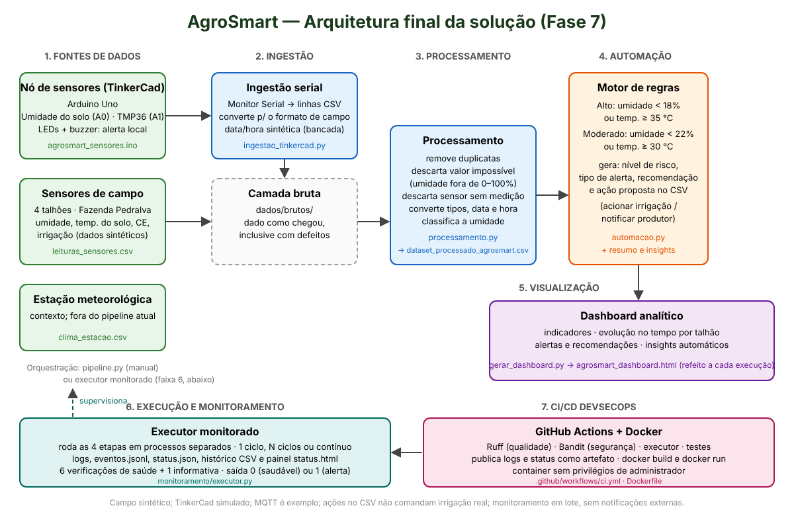

# AgroSmart — Arquitetura final da solução (Fase 7)



A solução junta, num fluxo único, o que foi feito nas fases anteriores: coleta de dados do ambiente, processamento, decisão automática e visualização. A Fase 7 acrescenta duas camadas ao redor desse fluxo: **execução e monitoramento** (o executor roda o pipeline, mede e avalia a saúde de cada ciclo) e **CI/CD DevSecOps** (GitHub Actions e Docker validam e executam o projeto a cada alteração). O fluxo de dados em si não mudou: `python pipeline.py` continua levando os dados do sensor até os arquivos que o dashboard lê.

## Componentes

### 1. Fontes de dados

| Componente | O que faz | Arquivo |
|---|---|---|
| **Nó de sensores (TinkerCad)** | Arduino Uno com sensor de umidade do solo e sensor de temperatura TMP36. Classifica o risco no próprio dispositivo e acende LED verde, amarelo ou vermelho; o buzzer toca no risco alto. Envia cada leitura em CSV pela serial. | `sensores/tinkercad/agrosmart_sensores.ino` |
| **Sensores de campo** | Leituras diárias de 4 talhões da Fazenda Pedralva (soja), de 05/06 a 02/09/2026: umidade e temperatura do solo, condutividade elétrica e irrigação aplicada. Tem três defeitos colocados de propósito (duplicata, valor impossível, sensor em falha) pra validação ter o que pegar. | `dados/brutos/leituras_sensores.csv` |
| **Estação meteorológica** | Chuva e temperatura do dia. Fica guardada na camada bruta como contexto; ainda não entra nas regras. | `dados/brutos/clima_estacao.csv` |

### 2. Ingestão
O TinkerCad não exporta o CSV neste fluxo: a saída do Monitor Serial é copiada para `dados/brutos/serial_tinkercad.txt`. O script converte as linhas para o formato de campo. Os timestamps de bancada são **sintéticos**: começam em 02/09/2026 10h UTC, separados por 1 h, só para ordenar as 34 observações. Não são o horário da captura em 03/10 nem o intervalo do Arduino (2 s). Séries temporais e indicadores agrícolas excluem a bancada.
**Arquivo:** `sensores/ingestao_tinkercad.py`

### 3. Processamento
Lê a camada bruta e entrega um dataset confiável:
- remove leituras duplicadas;
- descarta valores fisicamente impossíveis (umidade fora de 0–100%, temperatura fora de −10 a 60 °C);
- descarta leituras de sensor sem medição;
- rejeita datas inválidas ou identificação de sensor/talhão ausente; falha explicitamente quando falta coluna obrigatória;
- converte tipos, separa data e hora e classifica a umidade (Crítica, Baixa, Adequada, Alta).

Nenhum valor descartado é inventado no lugar: o descarte fica registrado em `registros_descartados.csv`.
**Arquivo:** `src/processamento.py` → `dados/processados/dataset_processado_agrosmart.csv`

### 4. Automação (motor de regras)
Interpreta cada leitura e decide sozinho:

| Nível de risco | Regra |
|---|---|
| Alto | umidade < 18% (limiar didático do cenário) **ou** temperatura ≥ 35 °C |
| Moderado | umidade < 22% (gatilho de irrigação) **ou** temperatura ≥ 30 °C |
| Normal | nenhuma das anteriores |

Para cada leitura gera nível de risco, tipo de alerta, recomendação e ação proposta. Para risco alto: **acionar irrigação** quando o talhão foi irrigado no período; caso contrário, **notificar o produtor**. Risco moderado gera monitoramento reforçado; normal não gera ação. Leituras parciais sem condição de alerta ficam em **Sem dados**, não em Normal. O campo `talhao_irrigado` é inferido de qualquer volume positivo no período inteiro, não de cadastro físico; o protótipo analisa um lote histórico. A automação calcula o resumo por talhão e os insights a partir dos dados de campo.

Os limiares de umidade de 18/22% são adaptações do cenário local, implementadas também no Arduino. A estrutura do motor de regras parte da contribuição de Joy; não declarar que seus parâmetros originais foram mantidos.

**Limite da integração:** ações são textos registrados no CSV. Nenhum comando de bomba, API externa ou mensagem é executado. A regra de irrigação em risco alto, inclusive para calor, exigiria revisão agronômica e controle seguro de atuadores num sistema real. Neste dataset, todos os riscos altos são em talhões sem irrigação; o ramo irrigado está coberto por teste de cenário.
**Arquivo:** `src/automacao.py` → `resultado_automacao_agrosmart.csv`, `resumo_talhoes.csv`, `insights_automaticos.csv`

### 5. Visualização
Dashboard analítico gerado pelo pipeline a partir dos três arquivos da automação: indicadores, evolução diária por talhão, limites, alertas, ações propostas e insights. HTML e SVG estão no mesmo arquivo, sem JavaScript ou CDN: abre offline. O arquivo é uma fotografia do último processamento; é preciso executar o pipeline e reabrir para atualizar. Tabelas e gráfico de riscos incluem a bancada, identificada; indicadores agrícolas e séries temporais não a incluem.
**Arquivo:** `dashboard/gerar_dashboard.py` → `dashboard/agrosmart_dashboard.html`

A contribuição inicial de Zerlin (`dashboard/powerbi_versao_inicial/`) permanece preservada como referência histórica: usa outro dataset e não foi atualizada. O painel integrado entregue é `dashboard/agrosmart_dashboard.html`; o enunciado aceita ferramenta equivalente, sem exigir PBIX.

### 6. Execução e monitoramento (Fase 7)
O executor roda as quatro etapas do pipeline em processos separados, mede a duração de cada uma, grava logs, calcula indicadores a partir das saídas reais e avalia seis verificações de saúde (etapas, arquivos de saída atualizados, taxa de descarte, leituras sem dados, leituras de campo em alerta e duração) mais uma informativa (atualidade dos dados). Termina com código `0` (saudável) ou `1` (alerta ou falha), o que permite usá-lo em agendadores e no CI. Se uma etapa falha, o pipeline é interrompido e os indicadores não são calculados, para não apresentar arquivos antigos como atuais.
**Arquivo:** `monitoramento/executor.py` → `logs/agrosmart.log`, `logs/eventos.jsonl`, `status.json`, `historico_execucoes.csv`, `status.html`. Detalhes em `monitoramento/MONITORAMENTO.md`.

### 7. CI/CD DevSecOps (Fase 7)
A cada push ou pull request na `main`, o GitHub Actions executa o job `quality-and-security` (Ruff, Bandit, executor monitorado, testes, upload de logs e status como artefato) e o job `docker-build` (build da imagem e execução do container, com usuário sem privilégios de administrador). O código de saída do executor faz o job falhar quando há ALERTA.
**Arquivos:** `.github/workflows/ci.yml`, `Dockerfile`, `.dockerignore`, `ruff.toml`, `requirements-dev.txt`. Detalhes em `docs/pipeline_devsecops.md`.

## Fluxo dos dados

```
Arduino (TinkerCad) ──serial──► ingestao_tinkercad.py ─┐
Sensores de campo ─────────────────────────────────────┼─► dados/brutos/
Clima e produtividade: contexto bruto, fora do pipeline atual    │
                                                                ▼
                                                      processamento.py
                                                                │
                                                                ▼
                                                        automacao.py
                                                                │
                                                                ▼
                                            gerar_dashboard.py (painel HTML)

monitoramento/executor.py ── roda e supervisiona as 4 etapas ──► logs, status.json, status.html
GitHub Actions + Docker ──── executa o executor e os testes ──► workflow verde/vermelho
```

## Limitações (pra ser honesto na entrega)
- Os dados de campo são sintéticos, gerados por um modelo simples de balanço hídrico (cenário da Fase 5). São coerentes, mas não são medições reais.
- A ligação TinkerCad → Python é manual (copiar o Monitor Serial), porque o simulador não exporta dados. Num dispositivo real, o envio seria por MQTT (exemplo de payload em `dados/brutos/payload_sensor_mqtt.json`).
- As regras são fixas; uma evolução possível é trocar o motor de regras por um modelo treinado com o histórico.
- A comparação dos talhões é descritiva de um cenário sintético; não prova efeito causal de irrigação.
- O motor de regras não consulta clima/produtividade, embora esses arquivos componham o contexto do cenário.
- O monitoramento é em lote: cada ciclo reprocessa os CSVs. Não há leitura de sensores em fluxo, processo residente com métricas em tempo real nem envio de alertas por e-mail ou mensagem.
- O CI cobre o código-fonte (Ruff e Bandit). Não há varredura de dependências nem de imagem, e o pipeline não faz deploy.
